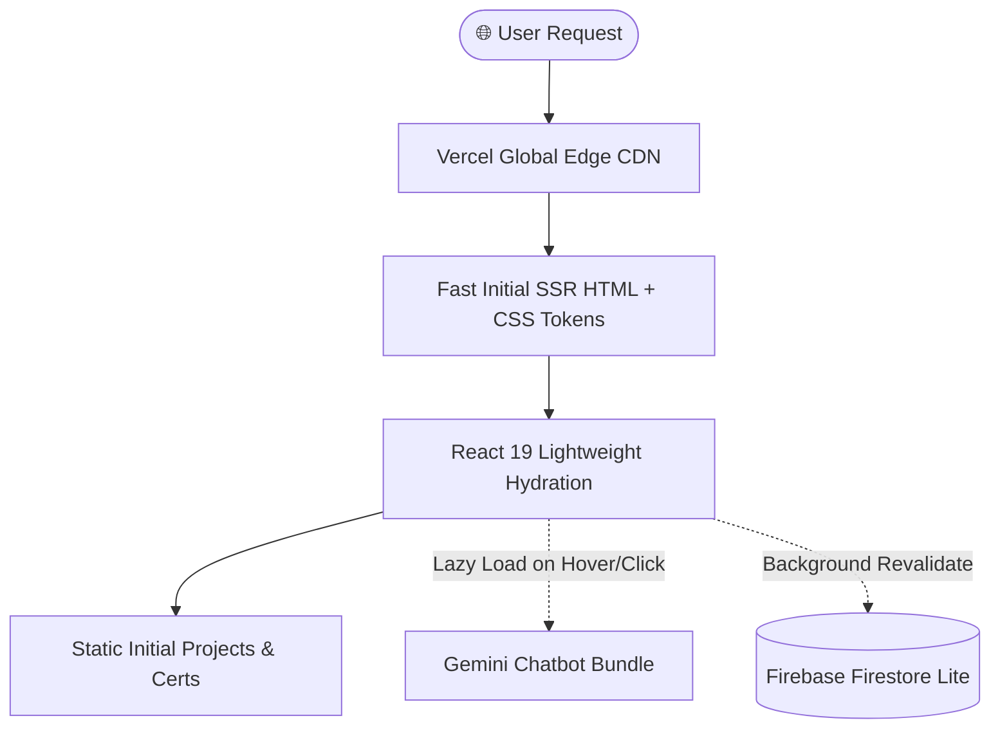

<div align="center">

# ⚡ Reda Salem — Portfolio & Engineering Showcase

**A High-Performance, Next-Generation Portfolio built with Next.js 16, React 19, Tailwind CSS v4, and Gemini AI.**

[](https://reda-website.vercel.app)
[](https://reda-website.vercel.app)
[](https://nextjs.org/)
[](https://react.dev/)
[](https://tailwindcss.com/)
[](https://ai.google.dev/)

<br />

<p align="center">
  <a href="#-key-features">Features</a> •
  <a href="#-tech-stack">Tech Stack</a> •
  <a href="#-architecture--performance">Performance</a> •
  <a href="#-project-structure">Structure</a> •
  <a href="#-getting-started">Getting Started</a> •
  <a href="#-connect">Connect</a>
</p>

</div>

---

## 🌟 Overview

This repository houses the source code for **Reda Salem's** personal portfolio and full-stack engineering showcase. Engineered for maximum speed, rich aesthetics, and seamless user experience, the website combines cutting-edge web technologies with a bespoke **Cyber-Neo design system**.

> **Live Website:** [https://reda-website.vercel.app](https://reda-website.vercel.app)

---

## 🚀 Key Features

### 1. 🔮 Cyber-Neo Visual System & Multi-Color Glow
* **Dynamic Color Tokens:** Built on native `OKLCH` color spaces featuring **Neo-Mint (`#00e08e`)**, **Electric Violet (`#8b5cf6`)**, **Cyber Cyan (`#06b6d4`)**, and **Warm Amber (`#f59e0b`)**.
* **GPU-Accelerated Ambient Orbs:** 4 floating ambient orbs and a noise texture overlay powered 100% by pure CSS `@keyframes` with zero JavaScript animation overhead.
* **Animated Gradient Typography:** CSS-composited shifting text gradients on headers and hero sections.
* **Rotating Conic-Gradient Borders:** Interactive hover glow on cards with glassmorphism depth.

### 2. ⚡ Ultra-Fast Interactive Hero & Terminal
* **3D Parallax Tilt Panel:** Lightweight pointer-tracking perspective panel without heavy dependencies.
* **Live Typing Terminal:** Code snippet simulator with syntax-highlighted code lines and real-time blinking cursor.
* **Instant First Contentful Paint (FCP):** Non-blocking hero typography delivering immediate visual rendering.

### 3. 🤖 Custom AI Assistant (Reda AI v2.0)
* **Custom Cybernetic Hex-Visor Hologram Icon:** An exclusive vector-engineered AI core avatar with orbital nodes and quantum singularity aura.
* **Google Gemini AI Integration:** Live intelligent conversational bot trained on engineering projects, tech stack, and experience.
* **Smart On-Demand Chunk Loading:** Loads chatbot bundles only on user interaction or hover to guarantee a lightweight initial page payload.

### 4. 💼 Case Studies & Instant Project Engine
* **Hybrid Data Strategy:** Instant initial SSR render with background Firebase Firestore Lite revalidation.
* **Interactive Media Surfaces:** Multi-layer gradient overlays, featured badges, and direct links to live demos and source repositories.

### 5. 🏆 Credentials & Achievements
* **Curated Certification Grid:** Interactive certifications (Hsoub Academy, ITI, Huma-volve, Google for Developers).
* **Per-Card Visual Identity:** Distinctive accent gradients and verified credential links.

### 6. 📱 Responsive Navigation Architecture
* **Collapsible Desktop Sidebar:** Smooth collapse transition with animated color-cycling avatar ring (`avatar-ring`), centered icon controls, and zero-scrollbar layout.
* **Mobile Glass Bottom Bar:** Frosted glass navbar with per-tab active indicators and slide-up animations.

---

## 🛠 Tech Stack

| Layer | Technologies |
| :--- | :--- |
| **Framework** | [Next.js 16 (App Router)](https://nextjs.org/), [React 19](https://react.dev/) |
| **Styling** | [Tailwind CSS v4](https://tailwindcss.com/), CSS Modules, OKLCH Design Tokens |
| **AI / LLM** | [Google Generative AI SDK (Gemini)](https://ai.google.dev/) |
| **Database / Backend** | [Firebase Firestore Lite](https://firebase.google.com/) |
| **Animations** | Hardware-accelerated CSS3, [Framer Motion](https://www.framer.com/motion/) |
| **Icons & Media** | [Lucide React](https://lucide.dev/), [React Icons](https://react-icons.github.io/react-icons/) |
| **Fonts & SEO** | `next/font` (Geist & Geist Mono), JSON-LD Schemas (Person, WebSite, ProfessionalService) |
| **Deployment** | [Vercel](https://vercel.com/) |

---

## ⚡ Architecture & Performance Optimizations



* **Zero Frame-Dropping Loops:** Eliminated continuous unthrottled JavaScript `requestAnimationFrame` loops in favor of native CSS hardware acceleration (`transform-gpu` / `will-change`).
* **Micro-Optimized Assets:** Converted bloated raster favicons to high-precision, sub-kilobyte inline SVG vectors.
* **Conditional Analytics Pipeline:** Lazy-loaded third-party analytics (Google Analytics & Microsoft Clarity) guarded against idle queue blocking.
* **Comprehensive JSON-LD Schemas:** Embedded structured metadata for Person, WebSite, ProfessionalService, and BreadcrumbList.

---

## 📁 Project Structure

```bash
reda-website/
├── app/
│   ├── globals.css              # Cyber-Neo color system, OKLCH tokens, animations
│   ├── layout.tsx               # Root layout, fonts, SEO metadata & JSON-LD
│   └── page.tsx                 # Dynamic section loader & suspense boundaries
├── components/
│   ├── ai-avatar-icon.tsx       # Custom holographic AI Cyber-Core SVG component
│   ├── animated-background.tsx  # Multi-color GPU ambient orbs
│   ├── chatbot-loader.tsx       # On-demand lazy loader with live neon beacon
│   ├── chatbot.tsx              # Gemini AI chat interface with modal animations
│   ├── hero.tsx                 # Parallax tilt terminal & gradient typography
│   ├── skills.tsx               # Tech stack categories with hover gradient borders
│   ├── projects.tsx             # Project cards with interactive media previews
│   ├── certificates.tsx         # Verified certification cards with custom badges
│   ├── contact.tsx              # Frosted glass form with multi-color input focus
│   ├── sidebar.tsx              # Desktop collapsible sidebar with avatar glow
│   ├── Navbar.tsx               # Mobile floating frosted glass navigation
│   └── footer.tsx               # Footer with gradient divider and quick links
├── data/
│   ├── projects.ts              # Instant static fallback projects data
│   └── skills.ts                # Skill categories and technology lists
├── lib/
│   └── firestore.ts             # Firebase Firestore Lite dynamic client
└── public/
    ├── favicon.svg              # Lightweight vector brand icon
    └── images/                  # Optimized media and certification assets
```

---

## 💻 Getting Started

### Prerequisites

* **Node.js**: `v18.17.0` or higher
* **Package Manager**: `npm`, `pnpm`, or `yarn`

### Installation

1. **Clone the repository:**
   ```bash
   git clone https://github.com/redasalem/reda-website.git
   cd reda-website
   ```

2. **Install dependencies:**
   ```bash
   npm install
   ```

3. **Configure Environment Variables:**
   Create a `.env.local` file in the root directory:
   ```env
   # Google Gemini API Key
   NEXT_PUBLIC_GEMINI_API_KEY=your_gemini_api_key_here

   # Web3Forms (for contact form submissions)
   NEXT_PUBLIC_WEBFORMS=your_web3forms_access_key

   # Analytics (Optional)
   NEXT_PUBLIC_GA_ID=your_google_analytics_id
   NEXT_PUBLIC_CLARITY_ID=your_microsoft_clarity_id
   NEXT_PUBLIC_SITE_URL=https://reda-website.vercel.app
   ```

4. **Run Development Server:**
   ```bash
   npm run dev
   ```
   Open [http://localhost:3000](http://localhost:3000) with your browser.

5. **Build for Production:**
   ```bash
   npm run build
   npm run start
   ```

---

## 📬 Connect with Me

<div align="center">

[](https://github.com/redasalem)
[](https://www.linkedin.com/in/reda-salem-dev/)
[](mailto:redasalem287@gmail.com)
[](tel:+201121696299)

<br />

**© 2026 Reda Salem. All rights reserved.**

</div>
